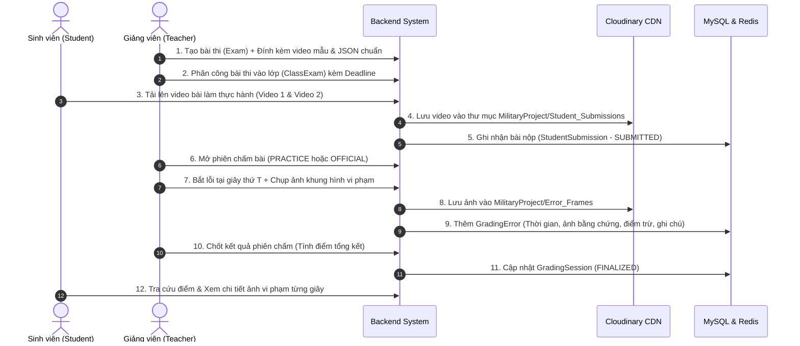

# 🎓 HỆ THỐNG QUẢN LÝ & CHẤM THI THỰC HÀNH TRỰC TUYẾN QUA VIDEO

### 📌 Đồ Án Tốt Nghiệp - Backend RESTful API (Spring Boot & Micro-Services Architecture)

[](https://www.oracle.com/java/)
[](https://spring.io/projects/spring-boot)
[](https://spring.io/projects/spring-security)
[](https://www.mysql.com/)
[](https://redis.io/)
[](https://cloudinary.com/)
[](https://www.docker.com/)

---

## 📖 1. Giới Thiệu Dự Án (Overview)

Dự án **Hệ thống Quản lý và Chấm thi Thực hành Trực tuyến qua Video** là giải pháp phần mềm Backend hiệu năng cao, được thiết kế chuyên biệt cho việc quản lý đào tạo, tổ chức thi cử và đánh giá kỹ năng thực hành (huấn luyện điều lệnh, thao tác quân sự, bài tập thể lực, kỹ thuật) thông qua video ghi hình bài làm của sinh viên/học viên.

Hệ thống số hóa toàn bộ quy trình: từ tổ chức lớp học, đăng tải video mẫu, thu nhận bài nộp đa góc quay, thiết lập bộ tiêu chí lỗi và điểm trừ, đến phiên chấm bài trực quan từng khung hình (timestamp & evidence snapshot) và tự động chốt điểm khi hết hạn chấm.

---

## ✨ 2. Tính Năng Nổi Bật (Key Features)

### 🔐 Phân quyền người dùng (Role-Based Access Control - RBAC)

Hệ thống hỗ trợ 3 phân quyền chuyên biệt với cơ chế bảo mật cao:

1. **Quản trị viên (ADMIN)**:

   - Quản lý tài khoản: Thêm, sửa, khóa/mở khóa tài khoản, phân quyền.
   - Quản lý lớp học: Tạo lớp, phân công giảng viên phụ trách, sửa thông tin lớp.
   - Nhập dữ liệu hàng loạt: Import người dùng, lớp học và phân lớp sinh viên qua file **Excel (.xlsx)** bằng Apache POI.
   - Quản lý danh mục loại bài thi (Exam Type): CRUD, xóa mềm (Soft Delete) và khôi phục (Restore).
2. **Giảng viên (TEACHER)**:

   - **Quản lý đề thi**: Thiết lập bài thi kèm video mẫu chuẩn và dữ liệu chuẩn (`standardData` dạng JSON).
   - **Phân bổ bài thi cho lớp (ClassExam)**: Thiết lập hạn chót nộp bài (`submissionDeadline`) và hạn chót chấm bài (`gradingDeadline`).
   - **Quản lý tiêu chí lỗi (ErrorType)**: Tùy biến bộ quy tắc lỗi với mức độ nghiêm trọng (`LOW`, `MEDIUM`, `HIGH`, `CRITICAL`) và số điểm trừ tương ứng.
   - **Phiên chấm bài trực quan (GradingSession)**:
     - Hỗ trợ 2 chế độ: **Luyện tập (PRACTICE)** và **Chính thức (OFFICIAL)**.
     - Tua và dừng video theo mốc thời gian (timestamp).
     - Bắt lỗi chính xác theo từng giây (`frameTimeSeconds`), tự động chụp khung hình làm chứng cứ vi phạm (`frameImageUrl`), ghi chú và áp dụng điểm trừ.
     - Tính tổng điểm trừ và điểm tổng kết cuối cùng.
   - **Thống kê & Báo cáo Dashboard**:
     - Tổng quan tình hình giảng dạy và chấm thi.
     - Phân bố tỷ lệ lỗi theo từng lớp học.
     - Biểu đồ Top 5 lỗi sinh viên mắc phải nhiều nhất.
   - Lịch sử chấm thi của giảng viên theo từng bài thi và học kỳ.
3. **Sinh viên (STUDENT)**:

   - Xem danh sách bài thi được phân công theo lớp.
   - Nộp bài thi thực hành: Hỗ trợ nộp nhiều góc quay video (Video góc chính, Video góc phụ) và dữ liệu bài nộp JSON (`studentData`).
   - Xem bảng điểm cá nhân và bảng điểm tổng hợp của lớp.
   - Xem chi tiết phản hồi bài thi: Từng lỗi vi phạm, số điểm bị trừ, hình ảnh bằng chứng tại khung hình vi phạm và lời phê của giáo viên.

---

## ⚡ 3. Kiến Trúc & Công Nghệ Cốt Lõi (Architecture & Tech Stack)

| Hạng mục                       | Công nghệ sử dụng                             | Mục đích                                                                                              |
| :------------------------------- | :------------------------------------------------ | :------------------------------------------------------------------------------------------------------- |
| **Backend Framework**      | **Spring Boot 3.3.5**                       | Core framework, RESTful API                                                                              |
| **Ngôn ngữ**             | **Java 21 (LTS)**                           | Tận dụng Virtual Threads, Pattern Matching & tối ưu runtime                                          |
| **Bảo mật**              | **Spring Security 6 + JWT**                 | Xác thực phân quyền không lưu trạng thái (Stateless), Token lưu trong HTTP-Only Cookie          |
| **Chống Spam / DoS**      | **Redis Rate Limiting (Fixed Window)**      | Giới hạn 100 requests/phút/IP qua`RateLimitFilter`                                                  |
| **Bộ nhớ đệm (Cache)** | **Redis 7.2 + Spring Cache**                | Caching dữ liệu đọc nhiều (User, Class, Exam, ErrorType) với TTL đa tầng từ 3-15 phút          |
| **Cơ sở dữ liệu**      | **MySQL 8.0 + Hibernate 6**                 | Lưu trữ quan hệ ACID, hỗ trợ cột JSON Type cho dữ liệu tọa độ/động tác                     |
| **Lưu trữ đám mây**   | **Cloudinary API**                          | Quản lý và phân phối CDN cho video bài nộp, video mẫu, ảnh bằng chứng vi phạm và avatar     |
| **Xử lý tài liệu**     | **Apache POI 5.2.5**                        | Đọc/ghi và kiểm tra hợp lệ dữ liệu file Excel khi import hàng loạt                             |
| **Email Service**          | **JavaMail + Thymeleaf**                    | Gửi email khôi phục mật khẩu với giao diện HTML mẫu chuyên nghiệp                              |
| **Tự động hóa**        | **Spring Task Scheduling (`@Scheduled`)** | Quét và tự động chốt điểm bài thi quá hạn chấm vào 0h mỗi ngày (`AutoGradingFinalizer`) |
| **Containerization**       | **Docker & Docker Compose**                 | Đóng gói toàn bộ hệ thống (App, MySQL, Redis) sẵn sàng triển khai                              |

---

## 🏗️ 4. Cấu Trúc Thư Mục Dự Án (Project Structure)

```text
DoAnTotNghiep/
├── src/
│   ├── main/
│   │   ├── java/com/TrungHieu/DoAnTotNgiep/
│   │   │   ├── Cloudinary/           # Cấu hình hằng số & thư mục Cloudinary
│   │   │   ├── Config/               # AppConfig, RedisConfig (CacheManager, Jackson)
│   │   │   ├── Controller/           # REST Controllers tiếp nhận request từ client
│   │   │   ├── DTO/
│   │   │   │   ├── Request/          # Data Transfer Object cho các API request
│   │   │   │   └── Response/         # Chuẩn phản hồi ApiResponse<T>, DTO response
│   │   │   ├── Entity/               # JPA Entities (User, Exam, ClassExam, GradingSession...)
│   │   │   ├── Enum/                 # Enums: RoleType, GradingMode, SeverityType...
│   │   │   ├── Exception/            # GlobalExceptionHandler, AppException, ErrorCode
│   │   │   ├── Mapper/               # MapStruct mappers chuyển đổi DTO <-> Entity
│   │   │   ├── Repository/           # Spring Data JPA Repositories
│   │   │   ├── Security/             # JWT Filter, RateLimitFilter, SecurityConfig
│   │   │   ├── Service/              # Nghiệp vụ: Auth, Exam, Grading, Excel, Cloudinary...
│   │   │   └── DoAnTotNgiepApplication.java
│   │   └── resources/
│   │       ├── templates/            # Giao diện email Thymeleaf (email-forgot-password.html)
│   │       └── application.yaml      # Cấu hình hệ thống (Database, Redis, Mail, Cloudinary...)
├── Dockerfile                        # Dockerfile tối ưu chạy trên Eclipse Temurin 21 Alpine
├── docker-compose.yml                # File chạy cụm dịch vụ MySQL + Redis + Spring App
├── pom.xml                           # Quản lý dependencies & plugins Maven
└── README.md
```

---

## 🔄 5. Quy Trình Nghiệp Vụ Chấm Thi (Grading Workflow)



---

## 🚀 6. Hướng Dẫn Cài Đặt & Khởi Chạy (Installation & Getting Started)

### 📋 Yêu cầu môi trường (Prerequisites)

- **Java Development Kit (JDK)**: Phiên bản **21** trở lên.
- **Maven**: Phiên bản **3.9+** (hoặc dùng `mvnw` đi kèm).
- **MySQL Server**: Phiên bản **8.0+**.
- **Redis Server**: Phiên bản **7.0+**.
- **Docker & Docker Compose** *(Khuyến nghị để chạy nhanh nhất)*.

---

### 🐳 Cách 1: Khởi chạy nhanh bằng Docker Compose (Khuyên dùng)

Hệ thống đã cấu hình sẵn file `docker-compose.yml` gồm 3 containers:

1. `db-doantotnghiep`: MySQL 8.0 (Port `3306`)
2. `redis-doantotnghiep`: Redis 7.2 (Port `6379`)
3. `spring-be`: Spring Boot Application (Port `8080`)

#### Bước 1: Build file JAR trên máy chủ / host

```bash
# Windows
mvnw.cmd clean package -DskipTests

# Linux / MacOS
./mvnw clean package -DskipTests
```

#### Bước 2: Khởi động toàn bộ cụm dịch vụ

```bash
docker compose up -d --build
```

#### Bước 3: Kiểm tra trạng thái hoạt động

```bash
docker compose ps
docker compose logs -f spring-be
```

---

### 💻 Cách 2: Khởi chạy thủ công trên môi trường Development (Localhost)

#### Bước 1: Chuẩn bị Cơ sở dữ liệu và Redis

Tạo cơ sở dữ liệu MySQL:

```sql
CREATE DATABASE kbvaamfl_DoAnTotNgiep CHARACTER SET utf8mb4 COLLATE utf8mb4_unicode_ci;
```

Đảm bảo Redis server đang chạy tại cổng mặc định `6379`.

#### Bước 2: Cấu hình `src/main/resources/application.yaml`

Cập nhật thông tin kết nối phù hợp với máy của bạn:

```yaml
spring:
  datasource:
    url: jdbc:mysql://localhost:3306/kbvaamfl_DoAnTotNgiep?useSSL=false&allowPublicKeyRetrieval=true&serverTimezone=Asia/Ho_Chi_Minh&useUnicode=true&characterEncoding=UTF-8&createDatabaseIfNotExist=true
    username: root
    password: YOUR_MYSQL_PASSWORD
  data:
    redis:
      host: localhost
      port: 6379
```

#### Bước 3: Cấu hình Cloudinary & Mail

Cung cấp các thông tin API Cloudinary và App Password của Gmail trong `application.yaml`:

```yaml
jwt:
  signerKey: "YOUR_SIGNERKEY"

cloudinary:
  cloud-name: YOUR_CLOUD_NAME
  api-key: YOUR_API_KEY
  api-secret: YOUR_API_SECRET

spring:
  mail:
    username: YOUR_EMAIL@gmail.com
    password: YOUR_GMAIL_APP_PASSWORD
```

#### Bước 4: Chạy ứng dụng

```bash
# Dùng Maven Wrapper
mvnw.cmd spring-boot:run
```

Ứng dụng sẽ khởi động tại: `http://localhost:8080`.

---

## 📚 7. Danh Mục API Endpoints (API Documentation)

### 🔑 1. Xác thực & Tài khoản (Authentication & Authorization)

| Phương thức | Đường dẫn API                    | Quyền hạn | Mô tả chi tiết                                                  |
| :------------- | :----------------------------------- | :---------- | :----------------------------------------------------------------- |
| `POST`       | `/public/api/auth/login`           | Public      | Đăng nhập hệ thống, cấp Access & Refresh Token trong Cookie  |
| `POST`       | `/public/api/auth/refresh`         | Public      | Tự động làm mới Access Token từ Cookie`refreshToken`       |
| `POST`       | `/public/api/auth/forgot-password` | Public      | Quên mật khẩu, gửi email mã xác thực                        |
| `POST`       | `/public/api/auth/change-password` | Public      | Đổi mật khẩu mới                                              |
| `GET`        | `/public/api/auth/me/{username}`   | Public      | Lấy thông tin tài khoản hiện tại                             |
| `POST`       | `/admin/api/user/create`           | ADMIN       | Quản trị viên tạo tài khoản mới                             |
| `GET`        | `/admin/api/user`                  | ADMIN       | Lấy danh sách toàn bộ người dùng (phân trang)              |
| `PUT`        | `/admin/api/user/{id}`             | ADMIN       | Cập nhật thông tin người dùng                                |
| `PUT`        | `/admin/api/lock-user/{id}`        | ADMIN       | Khóa tài khoản người dùng                                    |
| `PUT`        | `/admin/api/unlock-user/{id}`      | ADMIN       | Mở khóa tài khoản                                              |
| `GET`        | `/admin/filter/user`               | ADMIN       | Lọc người dùng theo Role (`ADMIN`, `TEACHER`, `STUDENT`) |
| `POST`       | `/admin/import`                    | ADMIN       | Import danh sách người dùng từ file Excel                     |

---

### 🏫 2. Quản lý Lớp học (Class Management)

| Phương thức | Đường dẫn API                    | Quyền hạn    | Mô tả chi tiết                                    |
| :------------- | :----------------------------------- | :------------- | :--------------------------------------------------- |
| `POST`       | `/admin/api/class`                 | ADMIN          | Tạo lớp học mới                                  |
| `GET`        | `/admin/api/class`                 | ADMIN          | Danh sách lớp học (phân trang)                   |
| `PUT`        | `/admin/api/class`                 | ADMIN          | Phân công giảng viên giảng dạy lớp            |
| `PUT`        | `/admin/api/class/{id}`            | ADMIN          | Sửa thông tin lớp học                            |
| `DELETE`     | `/admin/api/class/{id}`            | ADMIN          | Xóa lớp học                                       |
| `POST`       | `/admin/import-classes`            | ADMIN          | Import danh sách lớp từ file Excel                |
| `POST`       | `/admin/import-to-class/{classId}` | ADMIN          | Import danh sách sinh viên vào lớp bằng Excel   |
| `POST`       | `/admin/api/class/student`         | ADMIN          | Thêm thủ công 1 sinh viên vào lớp              |
| `PUT`        | `/admin/api/class/user`            | ADMIN          | Xóa sinh viên khỏi lớp                           |
| `GET`        | `/classes/api/{id}`                | ADMIN, TEACHER | Lấy danh sách sinh viên trong lớp                |
| `GET`        | `/classes/total-student`           | ADMIN, TEACHER | Thống kê số lượng sinh viên theo từng lớp    |
| `GET`        | `/teacher/api/class/{id}`          | TEACHER        | Danh sách lớp được phân công cho giảng viên |

---

### 📝 3. Quản lý Bài thi & Loại bài thi (Exams & Exam Types)

| Phương thức | Đường dẫn API                     | Quyền hạn | Mô tả chi tiết                                  |
| :------------- | :------------------------------------ | :---------- | :------------------------------------------------- |
| `POST`       | `/api/admin/exam-type`              | ADMIN       | Tạo loại bài thi mới                           |
| `GET`        | `/api/teacher/exam-type`            | TEACHER     | Lấy danh sách loại bài thi đang kích hoạt   |
| `GET`        | `/api/admin/exam-type/exam`         | ADMIN       | Thống kê số lượng bài thi theo từng loại   |
| `PUT`        | `/api/admin/exam-type/{id}`         | ADMIN       | Cập nhật mã loại bài thi                      |
| `DELETE`     | `/api/admin/exam-type/{id}`         | ADMIN       | Xóa mềm loại bài thi                           |
| `PUT`        | `/api/admin/exam-type/{id}/restore` | ADMIN       | Khôi phục loại bài thi đã xóa mềm          |
| `POST`       | `/api/teacher/exam`                 | TEACHER     | Tạo bài thi mới (kèm video mẫu & JSON chuẩn) |
| `GET`        | `/api/exam/teacher/{idTeacher}`     | TEACHER     | Lấy danh sách bài thi của giảng viên         |
| `PUT`        | `/api/teacher/update-exam/{idExam}` | TEACHER     | Sửa thông tin bài thi                           |
| `DELETE`     | `/api/teacher/exam/{id}`            | TEACHER     | Xóa bài thi                                      |
| `PUT`        | `/api/teacher/exam/{id}`            | TEACHER     | Khôi phục bài thi                               |

---

### 📅 4. Phân công Bài thi cho Lớp (Class Exam Assignment)

| Phương thức | Đường dẫn API                   | Quyền hạn | Mô tả chi tiết                                    |
| :------------- | :---------------------------------- | :---------- | :--------------------------------------------------- |
| `POST`       | `/api/teacher/exam/class`         | TEACHER     | Gán bài thi cho lớp kèm hạn nộp và hạn chấm |
| `GET`        | `/public/exam/class/{idClass}`    | Public      | Lấy danh sách bài thi đang mở của lớp         |
| `DELETE`     | `/api/teacher/exam/class`         | TEACHER     | Gỡ bài thi khỏi lớp học                         |
| `GET`        | `/api/teacher/exam/class/deleted` | TEACHER     | Xem danh sách bài thi đã xóa khỏi lớp         |
| `POST`       | `/api/teacher/restore`            | TEACHER     | Khôi phục bài thi đã gỡ khỏi lớp             |

---

### ⚠️ 5. Quản lý Tiêu chí Lỗi (Error Types)

| Phương thức | Đường dẫn API                  | Quyền hạn | Mô tả chi tiết                                   |
| :------------- | :--------------------------------- | :---------- | :-------------------------------------------------- |
| `POST`       | `/api/teacher/error`             | TEACHER     | Tạo quy chuẩn lỗi (Tên, Mức độ, Điểm trừ) |
| `GET`        | `/api/teacher/error/{idTeacher}` | TEACHER     | Lấy danh sách lỗi do giảng viên cấu hình     |
| `DELETE`     | `/api/teacher/error/{id}`        | TEACHER     | Xóa loại lỗi                                     |
| `PUT`        | `/api/teacher/error/{id}`        | TEACHER     | Khôi phục loại lỗi                              |

---

### 📤 6. Nộp bài & Bảng điểm (Submissions & Gradeboard)

| Phương thức | Đường dẫn API                                  | Quyền hạn | Mô tả chi tiết                                             |
| :------------- | :------------------------------------------------- | :---------- | :------------------------------------------------------------ |
| `POST`       | `/student/submission`                            | STUDENT     | Sinh viên gửi nộp bài thi (kèm URLs video & JSON)        |
| `POST`       | `/teacher/submission/upload-video`               | TEACHER     | Giảng viên tải video bài thi trực tiếp cho sinh viên   |
| `GET`        | `/student/submission/{idStudent}`                | STUDENT     | Lịch sử các bài nộp của sinh viên                      |
| `GET`        | `/student/my-exam/{idStudent}`                   | STUDENT     | Danh sách bài thi và kết quả điểm của sinh viên      |
| `GET`        | `/teacher/class/{classExamId}/submissions`       | TEACHER     | Tổng hợp danh sách bài nộp của cả lớp trong đợt thi |
| `GET`        | `/public/grade-board/{classExamId}`              | Public      | Bảng điểm tổng hợp của đợt thi                        |
| `GET`        | `/public/grade-info/{submissionId}`              | Public      | Xem chi tiết kết quả điểm của 1 bài nộp               |
| `GET`        | `/public/class-grade-board/submission/{classId}` | Public      | Bảng điểm đầy đủ tất cả bài thi của lớp           |

---

### 🎯 7. Phiên Chấm Điểm & Bắt Lỗi (Grading Sessions & Errors)

| Phương thức | Đường dẫn API                                      | Quyền hạn | Mô tả chi tiết                                                      |
| :------------- | :----------------------------------------------------- | :---------- | :--------------------------------------------------------------------- |
| `POST`       | `/teacher/grading-session/start`                     | TEACHER     | Mở/tiếp tục phiên chấm bài (`PRACTICE` / `OFFICIAL`)         |
| `POST`       | `/teacher/grading-session/{idSession}/add-error`     | TEACHER     | Bắt lỗi tại thời điểm giây: lưu ảnh bằng chứng, trừ điểm |
| `GET`        | `/public/grading-error/{idSession}`                  | Public      | Lấy danh sách lỗi đã bắt trong phiên chấm                      |
| `POST`       | `/public/grading-session`                            | Public      | Tính toán tổng điểm trừ và điểm kết luận                    |
| `PUT`        | `/teacher/grading-session/{id}`                      | TEACHER     | Chốt phiên chấm (Chuyển trạng thái`FINALIZED`)                 |
| `GET`        | `/teacher/grading-session/submission/{idSubmission}` | TEACHER     | Danh sách các phiên chấm của 1 bài nộp                          |
| `GET`        | `/teacher/grading-session/history/{teacherId}`       | TEACHER     | Lịch sử các bài đã chấm của giảng viên                       |

---

### ☁️ 8. Tải Lên Đa Phương Tiện (Media Upload - Cloudinary)

| Phương thức | Đường dẫn API               | Quyền hạn | Mô tả chi tiết                              |
| :------------- | :------------------------------ | :---------- | :--------------------------------------------- |
| `POST`       | `/public/upload-sample`       | Public      | Upload video mẫu chuẩn lên Cloudinary       |
| `POST`       | `/public/upload-student-exam` | Public      | Upload video bài thi của sinh viên          |
| `POST`       | `/public/capture-error-frame` | Public      | Chốt khung hình vi phạm (Evidence Snapshot) |
| `POST`       | `/public/upload-avatar`       | Public      | Upload ảnh đại diện người dùng          |

---

### 📊 9. Thống Kê & Báo Cáo (Reports & Dashboard)

| Phương thức | Đường dẫn API                                     | Quyền hạn | Mô tả chi tiết                                                 |
| :------------- | :---------------------------------------------------- | :---------- | :---------------------------------------------------------------- |
| `GET`        | `/public/api/reports/summary?idTeacher=...`         | Public      | Thống kê số lượng bài thi, lớp học, tổng bài đã chấm |
| `GET`        | `/public/api/reports/errors-by-class?idTeacher=...` | Public      | Biểu đồ phân bố lỗi vi phạm theo từng lớp học           |
| `GET`        | `/public/api/reports/top-errors?idTeacher=...`      | Public      | Thống kê Top 5 lỗi phổ biến nhất sinh viên mắc phải      |

---

## 📦 8. Chuẩn Phản Hồi & Mã Lỗi Hệ Thống (Response & Error Standards)

### Cấu trúc phản hồi chung (`ApiResponse<T>`):

```json
{
  "code": 200,
  "message": "Thao tác thành công",
  "data": { ... }
}
```

### Bảng Mã Lỗi Phổ Biến (`ErrorCode`):

|    Mã Code    |   Trạng thái HTTP   | Thông điệp lỗi                                | Ý nghĩa                                               |
| :------------: | :-------------------: | :------------------------------------------------ | :------------------------------------------------------ |
| **1001** | `401 UNAUTHORIZED` | Login session expired or does not exist           | Phiên đăng nhập hết hạn hoặc chưa đăng nhập  |
| **1002** |   `403 FORBIDDEN`   | You do not have permission to access this feature | Không có quyền hạn truy cập                        |
| **1003** |  `400 BAD REQUEST`  | Incorrect old password                            | Mật khẩu cũ không đúng                            |
| **1004** | `401 UNAUTHORIZED` | Invalid token                                     | Token không hợp lệ                                   |
| **1011** |  `400 BAD REQUEST`  | The user's role is incorrect for this operation   | Sai vai trò người dùng                              |
| **2001** |   `409 CONFLICT`   | Data already exists in the system                 | Dữ liệu đã tồn tại trong hệ thống               |
| **2002** |   `404 NOT FOUND`   | Requested data not found                          | Không tìm thấy dữ liệu yêu cầu                   |
| **3001** | `422 UNPROCESSABLE` | Student must be assigned to a class               | Sinh viên bắt buộc phải thuộc về một lớp        |
| **3003** |    `423 LOCKED`    | Exam is expired                                   | Bài thi đã hết hạn nộp/hết hạn chấm            |
| **4001** |   `409 CONFLICT`   | Grading session is finalized                      | Phiên chấm đã được chốt, không thể sửa đổi |
| **9999** |   `500 INTERNAL`   | Uncategorized error                               | Lỗi hệ thống chưa được định nghĩa             |

---

## 🔒 9. Cơ Chế Bảo Mật & Hiệu Năng (Security & Performance)

1. **Bảo mật Token với HTTP-Only Cookie**:
   - Access Token và Refresh Token được lưu trong Cookie bảo mật (`HttpOnly = true`, `SameSite = Lax`, `Path = /`), ngăn chặn hoàn toàn tấn công **XSS**.
2. **Rate Limiting chống Spam & DDoS**:
   - `RateLimitFilter` sử dụng thuật toán **Fixed Window Counter** trên Redis.
   - Giới hạn tối đa **100 requests/phút** trên mỗi địa chỉ IP. Trả về mã lỗi `429 Too Many Requests` kèm Header `X-Rate-Limit-Retry-After-Seconds`.
3. **Chiến lược Bộ nhớ đệm (Redis Caching)**:
   - Áp dụng `@Cacheable`, `@CacheEvict` trên các hàm tra cứu danh sách giáo viên, lớp học, bài thi, loại lỗi.
   - Cơ chế `CacheErrorHandler` ghi log cảnh báo khi Redis gặp sự cố và cho phép fallback truy vấn trực tiếp MySQL mà không làm gián đoạn người dùng.
4. **Quản lý Media thông minh**:
   - Tách biệt rõ ràng các thư mục lưu trữ trên Cloudinary (`MilitaryProject/Sample_Videos`, `MilitaryProject/Student_Submissions`, `MilitaryProject/Error_Frames`, `MilitaryProject/Avatar_Image`).

---

## 👨‍💻 10. Tác Giả & Liên Hệ (Author & Credits)

- **Tác giả / Sinh viên thực hiện**: Đoàn Trung Hiếu
- **Dự án**: Backend Web chấm điểm các động tác quốc phòng 
- **Email**: hotro.booingfilmticket@gmail.com
- **Repository**: [GitHub Repository](https://github.com/doantrunghieu08/DoAnTotNghiep)

---

*⭐ Nếu bạn thấy dự án hữu ích, hãy để lại 1 Star trên GitHub nhé!*
