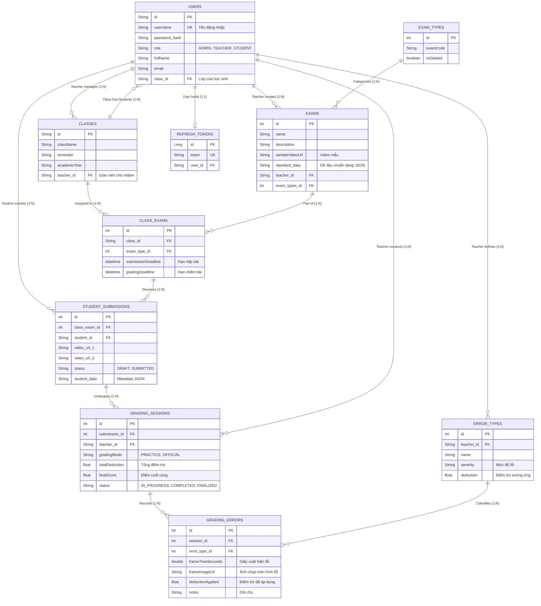
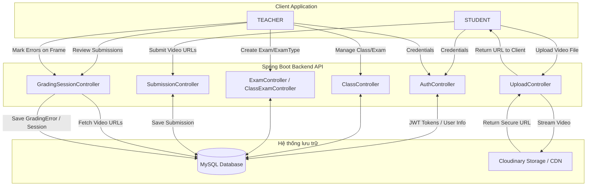
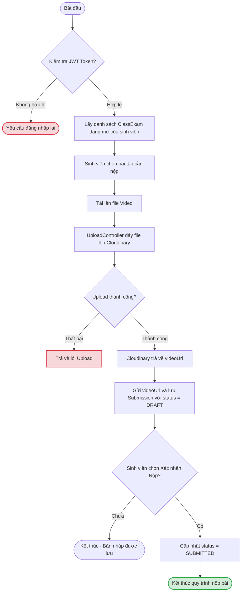
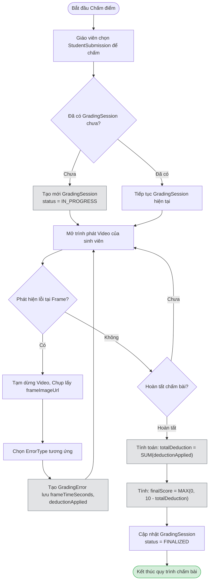

# System Design & Workflow: Video Grading System

Tài liệu này mô tả chi tiết thiết kế hệ thống, luồng dữ liệu (Data Flow Diagram), cấu trúc cơ sở dữ liệu (Database Design theo Crows Foot), và thuật toán xử lý nghiệp vụ của toàn bộ dự án.

## 1. Tổng quan hệ thống (System Overview)

Đây là một nền tảng trực tuyến phục vụ cho việc giao bài và nộp bài tập dưới định dạng video (ví dụ: các bài tập thực hành, thể dục, hoặc kỹ năng).
Hệ thống cho phép:

- Quản lý phân quyền giữa ADMIN, TEACHER, và STUDENT.
- Tạo danh mục lớp học, loại bài thi (ExamType) và bài thi (Exam).
- Giao bài thi cho một lớp cụ thể với các thời hạn (ClassExam).
- Sinh viên có thể quay và tải lên video bài làm của mình.
- Giáo viên xem lại video, đánh dấu lỗi trên từng khung hình (frame), áp dụng mức trừ điểm (deduction), và tính toán điểm tổng kết cuối cùng.

---

## 2. Database Design & Entity Relationship (Crows Foot ERD)

Sơ đồ dưới đây trình bày cấu trúc của các bảng (Tables) trong MySQL và mối quan hệ giữa chúng, được thiết kế theo chuẩn Crows Foot.

### Chi tiết các bảng (Table Details)

Dưới đây là mô tả chi tiết cấu trúc các bảng trong cơ sở dữ liệu MySQL, bao gồm kiểu dữ liệu, các ràng buộc và diễn giải.

#### 1. Bảng `users` (Người dùng)

Lưu trữ thông tin của tất cả người dùng trong hệ thống: Học sinh, Giáo viên và Quản trị viên.

| Tên cột                      | Kiểu dữ liệu | Ràng buộc            | Mô tả                                                    |
| :----------------------------- | :-------------- | :--------------------- | :--------------------------------------------------------- |
| `id`                         | VARCHAR         | **PK**           | Mã định danh duy nhất của người dùng               |
| `full_name`                  | VARCHAR         |                        | Họ và tên                                               |
| `username`                   | VARCHAR         | **UK, NOT NULL** | Tên đăng nhập (duy nhất)                              |
| `password_hash`              | VARCHAR         |                        | Mật khẩu (đã được mã hóa)                         |
| `role`                       | VARCHAR(Enum)   |                        | Vai trò: ADMIN, TEACHER, STUDENT                          |
| `birthday`                   | DATE            |                        | Ngày sinh                                                 |
| `email`                      | VARCHAR         |                        | Địa chỉ Email                                           |
| `gender`                     | VARCHAR(Enum)   |                        | Giới tính (MALE, FEMALE, OTHER...)                       |
| `status`                     | VARCHAR(Enum)   |                        | Trạng thái tài khoản                                   |
| `avatar_image`               | VARCHAR         |                        | Đường dẫn ảnh đại diện                             |
| `class_id`                   | VARCHAR         | **FK**           | Lớp học đang theo học (Nếu là Sinh viên)            |
| `is_require_password_change` | BOOLEAN         |                        | Yêu cầu đổi mật khẩu ở lần đăng nhập tiếp theo |
| `created_at`                 | DATETIME        | NOT NULL               | Thời gian tạo tài khoản                                |
| `updated_at`                 | DATETIME        |                        | Thời gian cập nhật gần nhất                           |

#### 2. Bảng `classes` (Lớp học)

Quản lý thông tin các lớp học, học kỳ và giáo viên phụ trách.

| Tên cột         | Kiểu dữ liệu | Ràng buộc  | Mô tả                                                  |
| :---------------- | :-------------- | :----------- | :------------------------------------------------------- |
| `id`            | VARCHAR         | **PK** | Mã lớp học                                            |
| `class_name`    | VARCHAR         |              | Tên lớp học                                           |
| `semester`      | VARCHAR         |              | Học kỳ                                                 |
| `academic_year` | VARCHAR         |              | Năm học                                                |
| `room_number`   | VARCHAR         |              | Phòng học                                              |
| `teacher_id`    | VARCHAR         | **FK** | Mã giáo viên phụ trách (Liên kết bảng `users`) |
| `created_at`    | DATETIME        | NOT NULL     | Thời gian tạo                                          |
| `updated_at`    | DATETIME        |              | Thời gian cập nhật gần nhất                         |

#### 3. Bảng `exam_types` (Loại bài thi)

Phân loại các bài thi/kiểm tra.

| Tên cột      | Kiểu dữ liệu | Ràng buộc                  | Mô tả                                |
| :------------- | :-------------- | :--------------------------- | :------------------------------------- |
| `id`         | INT             | **PK, Auto Increment** | Mã loại bài thi                     |
| `exam_code`  | VARCHAR         |                              | Mã loại bài (VD: MIDTERM, FINAL...) |
| `is_deleted` | BOOLEAN         |                              | Đánh dấu xóa mềm (Soft delete)    |
| `created_at` | DATETIME        | NOT NULL                     | Thời gian tạo                        |
| `updated_at` | DATETIME        |                              | Thời gian cập nhật gần nhất       |

#### 4. Bảng `exams` (Bài thi)

Chứa nội dung và yêu cầu chi tiết cho một bài thi mẫu do giáo viên tạo.

| Tên cột            | Kiểu dữ liệu | Ràng buộc                  | Mô tả                                                   |
| :------------------- | :-------------- | :--------------------------- | :-------------------------------------------------------- |
| `id`               | INT             | **PK, Auto Increment** | Mã bài thi                                              |
| `name`             | VARCHAR         |                              | Tên bài thi                                             |
| `description`      | TEXT            |                              | Mô tả chi tiết/Yêu cầu bài thi                      |
| `sample_video_url` | VARCHAR         |                              | Đường dẫn (URL) video mẫu để sinh viên tham khảo |
| `standard_data`    | JSON            |                              | Các tiêu chuẩn, metadata đánh giá dạng JSON        |
| `is_deleted`       | BOOLEAN         |                              | Đánh dấu xóa mềm                                     |
| `teacher_id`       | VARCHAR         | **FK**                 | Mã giáo viên ra đề (Liên kết `users`)            |
| `exam_types_id`    | INT             | **FK**                 | Loại bài thi (Liên kết `exam_types`)                |
| `created_at`       | DATETIME        | NOT NULL                     | Thời gian tạo                                           |
| `updated_at`       | DATETIME        |                              | Thời gian cập nhật gần nhất                          |

#### 5. Bảng `class_exams` (Giao bài thi cho lớp)

Ánh xạ (Mapping) giữa một Bài thi và một Lớp học cụ thể, cùng với các thời hạn.

| Tên cột               | Kiểu dữ liệu | Ràng buộc                  | Mô tả                                              |
| :---------------------- | :-------------- | :--------------------------- | :--------------------------------------------------- |
| `id`                  | INT             | **PK, Auto Increment** | Mã giao bài                                        |
| `class_id`            | VARCHAR         | **FK**                 | Lớp học được giao bài (Liên kết `classes`) |
| `exam_type_id`        | INT             | **FK**                 | Bài thi tương ứng (Liên kết `exams`)         |
| `submission_deadline` | DATETIME        |                              | Hạn chót sinh viên nộp bài                      |
| `grading_deadline`    | DATETIME        |                              | Hạn chót giáo viên chấm điểm                  |
| `is_deleted`          | BOOLEAN         |                              | Đánh dấu xóa mềm                                |
| `created_at`          | DATETIME        | NOT NULL                     | Thời gian tạo                                      |
| `updated_at`          | DATETIME        |                              | Thời gian cập nhật gần nhất                     |

#### 6. Bảng `student_submissions` (Bài nộp của sinh viên)

Lưu trữ thông tin bài nộp (video) của sinh viên cho một `class_exam`.

| Tên cột             | Kiểu dữ liệu | Ràng buộc                  | Mô tả                                                 |
| :-------------------- | :-------------- | :--------------------------- | :------------------------------------------------------ |
| `id`                | INT             | **PK, Auto Increment** | Mã bài nộp                                           |
| `class_exam_id`     | INT             | **FK**                 | Giao bài thi tương ứng (Liên kết `class_exams`) |
| `student_id`        | VARCHAR         | **FK**                 | Mã sinh viên nộp bài (Liên kết `users`)         |
| `video_url_1`       | VARCHAR         |                              | Đường dẫn video số 1 (Lưu trên Cloudinary)       |
| `file_size_bytes_1` | BIGINT          |                              | Dung lượng file video số 1                           |
| `video_url_2`       | VARCHAR         |                              | Đường dẫn video số 2 (Tùy chọn)                  |
| `file_size_bytes_2` | BIGINT          |                              | Dung lượng file video số 2                           |
| `status`            | VARCHAR(Enum)   |                              | Trạng thái nộp: DRAFT, SUBMITTED                     |
| `student_data`      | JSON            |                              | Metadata đính kèm dạng JSON                         |
| `submitted_at`      | DATETIME        | NOT NULL                     | Thời gian nộp bài                                    |

#### 7. Bảng `grading_sessions` (Phiên chấm điểm)

Ghi nhận quá trình giáo viên chấm một bài nộp. Có thể lưu tạm và tiếp tục chấm sau.

| Tên cột           | Kiểu dữ liệu | Ràng buộc                  | Mô tả                                                      |
| :------------------ | :-------------- | :--------------------------- | :----------------------------------------------------------- |
| `id`              | INT             | **PK, Auto Increment** | Mã phiên chấm bài                                        |
| `submission_id`   | INT             | **FK**                 | Bài nộp được chấm (Liên kết `student_submissions`) |
| `teacher_id`      | VARCHAR         | **FK**                 | Giáo viên thực hiện chấm (Liên kết `users`)         |
| `grading_mode`    | VARCHAR(Enum)   |                              | Chế độ chấm: PRACTICE, OFFICIAL                          |
| `total_deduction` | FLOAT           |                              | Tổng điểm trừ (Deduction) cộng dồn                     |
| `final_score`     | FLOAT           |                              | Điểm số tổng kết                                        |
| `status`          | VARCHAR(Enum)   |                              | Trạng thái: IN_PROGRESS, COMPLETED, FINALIZED              |
| `graded_at`       | TIMESTAMP       |                              | Thời gian thực hiện chấm/Cập nhật trạng thái         |

#### 8. Bảng `error_types` (Loại lỗi)

Giáo viên định nghĩa các loại lỗi có thể gặp và mức điểm trừ tương ứng.

| Tên cột       | Kiểu dữ liệu | Ràng buộc                  | Mô tả                                      |
| :-------------- | :-------------- | :--------------------------- | :------------------------------------------- |
| `id`          | INT             | **PK, Auto Increment** | Mã loại lỗi                               |
| `teacher_id`  | VARCHAR         | **FK**                 | Giáo viên tạo lỗi (Liên kết `users`) |
| `name`        | VARCHAR         |                              | Tên lỗi                                    |
| `description` | TEXT            |                              | Mô tả chi tiết lỗi                       |
| `severity`    | VARCHAR(Enum)   |                              | Mức độ nghiêm trọng của lỗi           |
| `deduction`   | FLOAT           |                              | Số điểm sẽ bị trừ khi mắc lỗi này   |
| `is_active`   | BOOLEAN         |                              | Trạng thái kích hoạt của lỗi           |
| `created_at`  | DATETIME        | NOT NULL                     | Thời gian tạo                              |
| `updated_at`  | DATETIME        |                              | Thời gian cập nhật gần nhất             |

#### 9. Bảng `grading_errors` (Lỗi được đánh dấu)

Chi tiết từng lỗi được giáo viên đánh dấu trên một khung hình (frame) cụ thể của video trong phiên chấm điểm.

| Tên cột              | Kiểu dữ liệu | Ràng buộc                  | Mô tả                                                       |
| :--------------------- | :-------------- | :--------------------------- | :------------------------------------------------------------ |
| `id`                 | INT             | **PK, Auto Increment** | Mã chi tiết lỗi                                            |
| `session_id`         | INT             | **FK**                 | Phiên chấm bài (Liên kết `grading_sessions`)           |
| `error_type_id`      | INT             | **FK**                 | Loại lỗi vi phạm (Liên kết `error_types`)              |
| `frame_time_seconds` | DOUBLE          |                              | Thời gian (tính bằng giây) xuất hiện lỗi trên Video   |
| `frame_image_url`    | VARCHAR         |                              | URL ảnh chụp màn hình lúc bị lỗi                       |
| `deduction_applied`  | FLOAT           |                              | Điểm trừ thực tế áp dụng tại thời điểm đánh dấu |
| `notes`              | VARCHAR         |                              | Ghi chú thêm của giáo viên                               |
| `created_at`         | DATETIME        | NOT NULL                     | Thời gian tạo                                               |
| `updated_at`         | DATETIME        |                              | Thời gian cập nhật gần nhất                              |

#### 10. Bảng `refresh_tokens` (Quản lý Token Đăng nhập)

Lưu trữ token để cấp lại quyền truy cập khi JWT Token hết hạn.

| Tên cột      | Kiểu dữ liệu | Ràng buộc                  | Mô tả                                             |
| :------------- | :-------------- | :--------------------------- | :-------------------------------------------------- |
| `id`         | BIGINT          | **PK, Auto Increment** | Mã Token                                           |
| `token`      | VARCHAR         | **UK, NOT NULL**       | Chuỗi Refresh Token                                |
| `user_id`    | VARCHAR         | **FK**                 | Người dùng sở hữu Token (Liên kết `users`) |
| `expires_at` | TIMESTAMP       | NOT NULL                     | Thời gian Token hết hạn                          |

---

## 3. Luồng dữ liệu tổng quát (Data Flow Diagram - DFD)

Sơ đồ dưới đây mô tả cách các tác nhân (Actors), API Server (Spring Boot Controller) và các hệ thống bên ngoài (DB, Cloudinary) trao đổi dữ liệu.

---

## 4. Các Luồng Nghiệp Vụ Chính (Algorithm / Workflow Flowcharts)

### 4.1 Luồng nộp bài của sinh viên (Student Submission Workflow)

Luồng này xử lý quá trình nộp bài thi bằng video, từ lúc upload đến khi xác nhận nộp bài chính thức.

### 4.2 Luồng chấm điểm của giáo viên (Teacher Grading Workflow)

Luồng này mô tả thao tác xem lại video, phát hiện lỗi, áp dụng ErrorType và tính tổng điểm (Final Score) thông qua Session.

